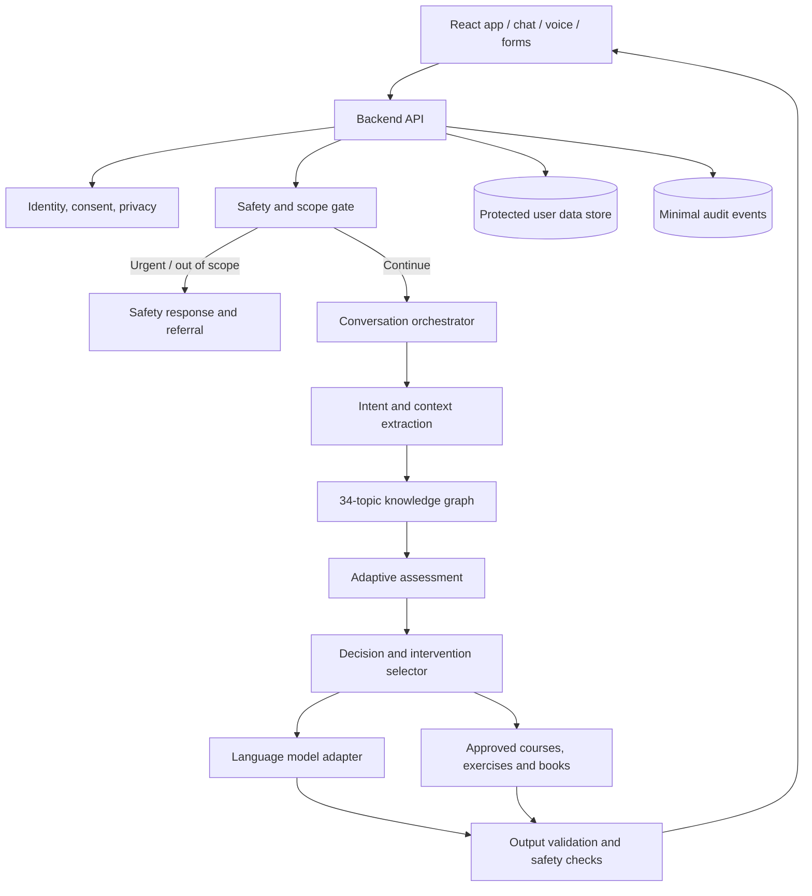

# معماری هدف دستیار هوشمند مسیر۲۸ — نسخه طراحی ۱.۰

**وضعیت:** طرح هدف، نیازمند تطبیق با کد و محتوای کامل  
**اصل معماری:** افزودن قابلیت به‌صورت تدریجی؛ عدم بازنویسی بی‌دلیل هسته فعلی  
**مرز صلاحیت:** ابزار آموزش و خودیاری مبتنی بر شواهد؛ نه روان‌درمانگر، ابزار تشخیص یا جایگزین خدمات اورژانسی.

## ۱. تجربه‌ای که باید ساخته شود

کاربر مسئله را با زبان طبیعی بیان می‌کند. دستیار:
1. منظور، هدف و زمینه را استخراج می‌کند.
2. در صورت ابهام فقط سؤال‌های لازم را می‌پرسد.
3. نشانه‌های خطر را مستقل و زودهنگام بررسی می‌کند.
4. یک یا چند موضوع مرتبط را به‌صورت فرضیه موقت نگه می‌دارد.
5. توضیحات جایگزین و عدم قطعیت را در نظر می‌گیرد.
6. محتوای تأییدشده و تمرین متناسب را پیشنهاد می‌کند.
7. بازخورد و تغییرات را ثبت و مسیر را بازبینی می‌کند.
8. در صورت نیاز کاربر را به متخصص یا خدمات فوری ارجاع می‌دهد.

## ۲. معماری منطقی

این نمودار یک هدف طراحی است؛ به معنی وجود این اجزا در مخزن فعلی نیست.

## ۳. لایه‌ها و مسئولیت‌ها

| لایه | مسئولیت | الزام |
|---|---|---|
| رابط کاربر | مکالمه، صدا، فرم و بازخورد | حفظ مسیرها و صفحات فعلی |
| API امن | کنترل نشست، اعتبارسنجی، محدودیت نرخ | هیچ کلید محرمانه در مرورگر نباشد |
| هویت و رضایت | هویت، رضایت، دسترسی و حذف | کمینه‌سازی داده |
| دروازه ایمنی | تشخیص نشانه خطر و محدودیت صلاحیت | مستقل از مدل زبانی |
| ارکستراتور | ترتیب فراخوانی اجزا و کنترل جریان | مدل به‌تنهایی تصمیم نهایی نگیرد |
| شبکه دانش | موضوع، زیرموضوع، مفهوم، ارتباط و شواهد | روابط قابل بازبینی و نسخه‌دار |
| ارزیابی تطبیقی | پرسش‌های هدفمند و توقف به‌موقع | از پرسش‌نامه بی‌پایان اجتناب شود |
| انتخاب مداخله | انتخاب تمرین و محتوای مناسب | فقط از محتوای تأییدشده |
| آداپتور مدل | اتصال قابل تعویض به ارائه‌دهنده مدل | عدم قفل‌شدن به یک فروشنده |
| حافظه | اهداف، ترجیحات، مسیر و بازخورد | رضایت، کنترل کاربر و حذف |
| پایش | سنجش تجربه، رفتار و عملکرد | عدم ادعای درمان بر اساس تکمیل دوره |

## ۴. قرارداد داده پیشنهادی

### Topic
- `topic_id`, `name`, `definition`, `scope`
- `category_ids`, `subtopic_ids`, `concept_ids`
- `assessment_ids`, `content_ids`, `safety_rule_ids`
- `status`, `version`, `reviewed_at`

### Relation
- `relation_id`, `source_id`, `target_id`
- `relation_type`: association | conceptual_overlap | hierarchy | possible_mechanism
- `direction`: one_way | bidirectional | not_applicable
- `mechanism`, `conditions`, `alternative_explanations`
- `evidence_ids`, `evidence_grade`, `review_status`
- `assessment_question_ids`, `intervention_ids`, `safety_rule_ids`

### Evidence
- شناسه منبع، عنوان، نویسنده/سازمان، سال، DOI/URL
- نوع مطالعه، جمعیت، محدودیت‌ها، نتیجه مرتبط
- درجه قطعیت، تاریخ بررسی، بازبین و وضعیت مجوز استفاده

### AssessmentQuestion
- شناسه، هدف ارزیابی، متن، نوع پاسخ، گزینه‌ها
- قواعد شاخه‌بندی، موضوع‌های مرتبط، هشدار ایمنی
- نسخه و وضعیت اعتبارسنجی

### Intervention / Exercise
- هدف، موارد کاربرد، موارد منع/احتیاط
- دستور اجرا، زمان تقریبی، سطح دشواری
- منبع پشتوانه، معیار توقف، شاخص بازخورد
- نسخه و تأییدکننده بالینی

### Content
- شناسه روز/دوره/کتاب/بخش
- موضوع و زیرموضوع مرتبط، هدف یادگیری
- سطح شواهد، نسخه، وضعیت بازبینی
- پیوند به تمرین‌ها و هشدارها

### UserMemory
- شناسه کاربر مستعار، هدف‌های اعلام‌شده، ترجیحات و محدودیت‌ها
- ارزیابی‌ها و بازخوردهای ضروری برای تداوم مسیر
- مبنای رضایت، زمان ایجاد، مدت نگهداری و وضعیت حذف
- داده خام حساس فقط در صورت ضرورت روشن و با حفاظت بیشتر

## ۵. مقیاس شواهد

درجه شواهد به هر رابطه و مداخله جداگانه اختصاص داده می‌شود؛ نوع رابطه به‌تنهایی قدرت شواهد را نشان نمی‌دهد.

| درجه | تعریف عملیاتی |
|---|---|
| E0 | هنوز بررسی نشده یا منبع قابل اتکا ثبت نشده |
| E1 | شواهد محدود، غیرمستقیم یا ناهمگون |
| E2 | شواهد مشاهده‌ای/مروری قابل توجه اما با محدودیت |
| E3 | شواهد نسبتاً قوی و همسو از چند مطالعه با کیفیت مناسب |
| E4 | پشتوانه قوی، تکرارشده و راهنمای بالینی معتبر برای کاربرد مشخص |

این مقیاس، چارچوب داخلی برای ممیزی است؛ معادل رسمی GRADE نیست و نباید بدون روش ارزیابی کیفیت مطالعه به‌صورت خودکار تخصیص یابد. علیت فقط در صورت شواهد مناسب ادعا شود.

## ۶. قواعد غیرقابل مذاکره موتور

1. هم‌زمانی دو مسئله علت بودن یکی برای دیگری را ثابت نمی‌کند.
2. شناسایی موضوع با تشخیص اختلال روان‌پزشکی یکسان نیست.
3. دستیار باید چند فرضیه را حفظ کند و با داده جدید آن‌ها را اصلاح یا رد کند.
4. پرسش‌ها باید با پاسخ کاربر تطبیق پیدا کنند؛ تکرار بی‌هدف ممنوع.
5. نبود رابطه در گراف به معنی ناممکن‌بودن آن نیست.
6. اجتناب همیشه ناسازگارانه نیست؛ ممکن است در برابر خطر واقعی محافظتی باشد.
7. مواجهه، محدودسازی خواب یا مداخلات پرریسک نباید خودکار و بدون غربالگری پیشنهاد شوند.
8. هیچ‌گاه دارو تجویز، قطع یا تغییر داده نشود.
9. در خطر فوری، ایمنی و ارجاع بر آموزش و نگهداشت کاربر در اپ مقدم است.
10. تکمیل ۲۸ روز یا افزایش امتیاز داخلی به‌تنهایی اثبات درمان نیست.

## ۷. وضعیت ایمنی

- **سطح عادی:** آموزش عمومی و تمرین کم‌خطر.
- **نیازمند ارزیابی بیشتر:** علائم شدید/پایدار، افت عملکرد، ابهام بالینی یا نیاز به ارزیابی تخصصی.
- **خطر فوری:** قصد/برنامه خودآسیبی یا آسیب به دیگری، خطر جاری خشونت یا وضعیت اورژانسی؛ توقف مسیر عادی و ارائه راهنمایی فوری متناسب با محل کاربر.

تشخیص خطر نباید فقط به طبقه‌بندی مدل متکی باشد. مسیرهای بحرانی باید با سناریوهای آزمون، قواعد صریح، بازبینی انسانی و پیام‌های ایمن اعتبارسنجی شوند.

## ۸. نقشه اجرا و معیار خروج

### مرحله صفر — شناخت کامل محصول
- بازیابی کامل path-content.json و تمام کتاب‌ها
- فهرست دقیق موضوع‌ها، روزها، تمرین‌ها، ارزیابی‌ها و منابع
- نقشه فایل‌ها، جریان داده، استقرار و سرویس‌های بیرونی
- خروجی: ممیزی محتوایی و فنی امضاشده

### مرحله یک — امنیت و حریم خصوصی
- مدل تهدید و جریان داده
- رضایت، حذف، نگهداری و کنترل دسترسی
- طراحی Backend و API بدون انتخاب فناوری پیش از بررسی زیرساخت
- خروجی: طراحی امنیتی و تصمیم معماری

### مرحله دو — مدل دانش
- تثبیت ۳۴ شناسه و زیرموضوع‌ها
- تعریف واژگان رابطه و شواهد
- ثبت منابع و تأیید بالینی
- خروجی: داده نسخه‌دار و قابل آزمون

### مرحله سه — دستیار حداقلی
- ورودی متن
- تشخیص نیت و استخراج مسئله
- پرسش‌گری تطبیقی
- پیشنهاد محتوای موجود
- مسیر ایمنی و ارجاع
- خروجی: پایلوت محدود، بدون ادعای تشخیص یا درمان

### مرحله چهار — حافظه و پایش
- حافظه اختیاری و قابل کنترل
- بازخورد و سنجش روند
- خروجی: تداوم امن بین جلسات

### مرحله پنج — اعتبارسنجی و انتشار
- آزمون امنیتی و حریم خصوصی
- آزمون سناریوهای بحران و خطای مدل
- آزمون کیفیت ارزیابی و انتخاب محتوا
- پایلوت کنترل‌شده و پایش پس از انتشار

## ۹. معیارهای پذیرش

- مسئله خارج از ۳۴ موضوع به‌درستی به مسیر «موضوع دیگر/ارجاع» هدایت شود.
- اطلاعات ناکافی باعث پرسش هدفمند شود، نه نتیجه‌گیری قطعی.
- پاسخ متناقض باعث بازنگری فرضیه شود.
- هم‌زمانی دو مشکل به‌اشتباه علت‌ومعلول نامیده نشود.
- تمرین تأییدنشده به‌عنوان توصیه معتبر عرضه نشود.
- نشانه خطر فوری مسیر عادی را متوقف کند.
- کاربر بتواند حافظه و رضایت خود را مشاهده و مدیریت کند.
- تکمیل روز ۲۸ معادل بهبود یا درمان معرفی نشود.
- هیچ داده حساس یا کلید محرمانه در لاگ یا بسته سمت کاربر افشا نشود.

## ۱۰. تصمیم‌های باز

این موارد تا پایان ممیزی نباید حدس زده شوند:
- Backend و دیتابیس مناسب
- ارائه‌دهنده مدل و محل پردازش داده
- روش احراز هویت و بازیابی حساب
- سیاست ذخیره‌سازی داده در مناطق قضایی مختلف
- محتوای واقعی ۳۴ دوره و تطابق آن با فهرست رسمی
- مجوز استفاده از پرسش‌نامه‌ها، کتاب‌ها و منابع
- امکان‌سنجی صدا و گفتار در نسخه نخست

## ۹. رجیستری ماشینی موضوعات

فایل `public/assistant/knowledge/topics.v1.json` به‌عنوان رجیستری نسخه‌دار ۳۴ موضوع ایجاد شد. هر موضوع شناسه پایدار T01 تا T34، ترتیب نمایش، وضعیت بازبینی و محل اتصال آتی زیرموضوع‌ها، روابط، شواهد، محتوا، مداخله و قواعد ایمنی دارد.

تعریف‌های عملیاتی عمداً `null` و وضعیت آن‌ها `pending_expert_review` است. پرکردن خودکار تعریف‌ها یا روابط علمی بدون منبع و بازبینی متخصص انجام نشده است. پرچم‌های بازبینی فقط موارد نیازمند تفکیک مفهومی را نشان می‌دهند و حکم بالینی نیستند.

اسکریپت `scripts/validate-assistant-topics.mjs` ترتیب، یکتایی شناسه‌ها، تعداد ۳۴ موضوع و قرارداد ساختاری را کنترل می‌کند. CI شماره ۴۲ این کنترل را همراه با آزمون‌ها، ممیزی وابستگی، اعتبارسنجی دوره‌ها و build با موفقیت اجرا کرد.

## ۱۰. مدل رضایت و ارزیابی تطبیقی — قرارداد طراحی

### رضایت
`public/assistant/privacy/consent-policy.v1.json` چهار هدف را جدا می‌کند: پردازش ابری AI، پردازش داده سلامت، حافظه بلندمدت AI و تحلیل محصول. همه پیش‌فرض‌ها false هستند. این فایل صرفاً مشخصات طراحی است و هیچ پردازش ابری را فعال نمی‌کند.

### تعریف‌ها و زیرموضوع‌ها
- `topic-definitions-draft.v1.json`: ۳۴ تعریف کاری و محدودیت دامنه؛ همه draft و در انتظار بازبینی متخصص.
- `subtopics.v1.json`: ۱۰۲ زیرموضوع اولیه، سه مورد برای هر موضوع؛ همه تأییدنشده.
- `topics.v1.json`: شناسه‌های پایدار و اتصال زیرموضوع‌ها و روابط.

### روابط و شواهد
- `relation-types.v1.json` واژگان رابطه را از همبستگی احتمالی، هم‌پوشانی مفهومی، تمایز، نقش احتمالی در شکل‌گیری/تداوم، عامل زمینه‌ای و تقدم ایمنی تفکیک می‌کند.
- `relations.v1.json` دارای ۴۰ پیوند کاندیدا است؛ همه `candidate_unreviewed`، بدون درجه شواهد، بدون ادعای علی و غیرفعال در runtime هستند.
- هیچ پیوندی برای انتخاب تمرین یا مداخله در نسخه اجرا استفاده نمی‌شود.

### ارزیابی
`assessment-protocol.v1.json` مراحل فهم مسئله، بررسی ایمنی در صورت نیاز، روشن‌سازی زمینه، تفکیک فرضیه‌ها، خلاصه مشترک، انتخاب محتوای تأییدشده و پیگیری را تعریف می‌کند. سقف سه فرضیه هم‌زمان و یک سؤال در هر نوبت ثبت شده؛ خروجی تشخیصی و توصیه دارویی ممنوع است. پروتکل تا بازبینی بالینی و ایمنی غیرفعال است.
